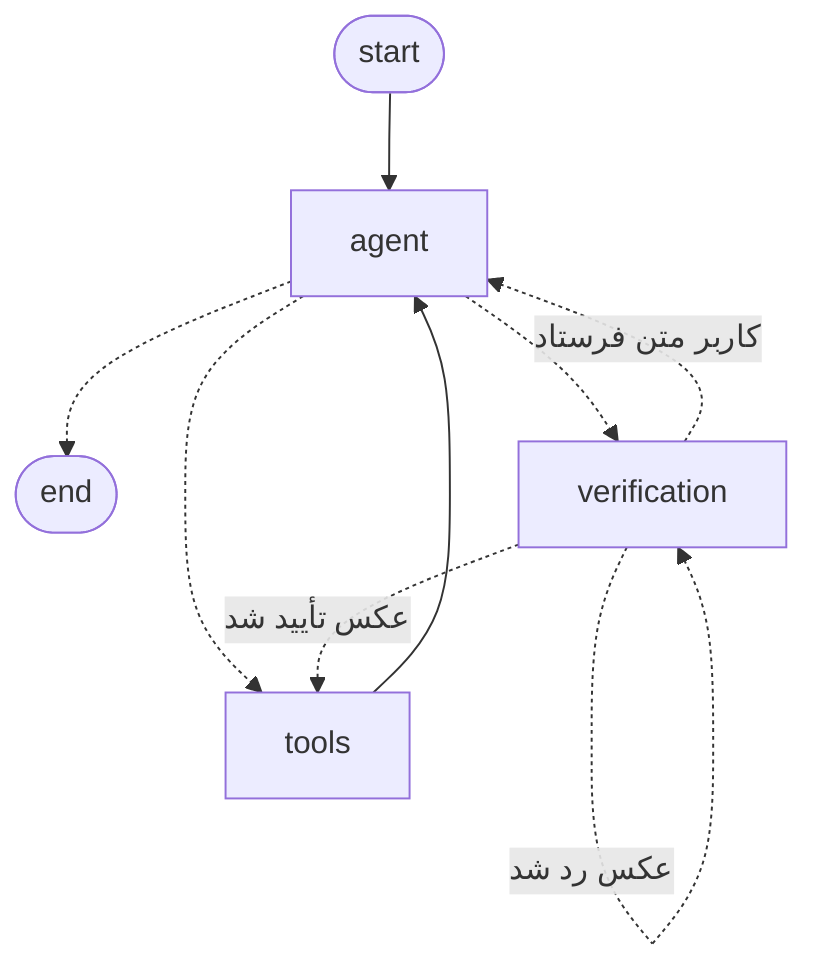

# erp-fa — دستیار هوشمند فارسی

یه دستیار گفتگومحور فارسی که به دیتابیس یه سازمان وصل میشه قیمت و مقدار مصرف محصولات کشاورزی رو حساب میکنه و بعد از احراز هویت با عکس اطلاعات شخصی کاربر مثل مالیات و خلافی و بیمه رو بهش میده

## چطور کار میکنه

```
Gradio (app.py)     FastAPI (api.py)        MCP (mcp_server.py)
   │                    │                        │ فقط ابزارهای عمومی
   └────────┬───────────┘                        │
            │                                    │
LangGraph agent (agent.py)  ── LLM خودش ابزار مناسب را انتخاب می‌کند
   │
tools.py ── search_products / get_product / calculate_usage / citizen_service / search_regulations
   │                                                              │
database.py ── data/erp.db (SQLite)                 rag.py ── آیین‌نامه + امبدینگ محلی

verification.py ── مدل بینایی: شخص + کارت ملی → کد ملی → جستجو در پایگاه داده
```

### گراف LangGraph



- **انسان در حلقه (HITL):** اگه مدل اطلاعات شخصی بخواد و کاربر احراز هویت نشده باشه نود `verification` با `interrupt` گراف رو متوقف میکنه وقتی عکس برسه گراف با `Command(resume=...)` از همون نقطه ادامه میده و همون درخواست رو کامل میکنه وضعیت هر جلسه رو هم checkpointer نگه میداره
- **بدون intent classifier:** تشخیص نوع درخواست با tool-calling خود مدل انجام میشه
- **محاسبات توی کد:** دوز و تعداد بسته و تخفیف حجمی و هزینه رو `calculate_usage` حساب میکنه نه مدل
- **RAG محلی:** آییننامه ماده به ماده تکه میشه و با `intfloat/multilingual-e5-small` روی CPU و بدون نیاز به API جستجو میشه مدل هم توی جوابش اسم ماده رو میگه
- **ردپای پاسخ:** کنار چت نشون داده میشه که کدوم ابزار با چه ورودی صدا زده شده و چی برگردونده

## اجرا

```bash
python -m venv .venv
.venv/Scripts/pip install -r requirements.txt
cp .env.example .env        # کلید AvalAI رو داخلش بذار
.venv/Scripts/python app.py
```

بعدش آدرس <http://127.0.0.1:7860> رو توی مرورگر باز کن

## API

```bash
.venv/Scripts/python -m uvicorn api:app --port 8000
```

| مسیر | کار |
|---|---|
| `POST /chat` | گفتگو با دستیار که پاسخ و ردپا و `session_id` برمیگردونه |
| `POST /verify` | احراز هویت با عکس برای یه `session_id` |
| `GET /products?q=&category=` | جستجوی محصولات |
| `GET /products/{sku}` | مشخصات یه محصول |
| `/docs` | مستندات تعاملی (Swagger) |
| `/ui` | همون رابط Gradio روی همین سرور |

## MCP

ابزارهای عمومی (`search_products` و `get_product` و `calculate_usage` و `search_regulations`) از طریق MCP هم در دسترس هستن اطلاعات شخصی عمدا توی MCP گذاشته نشده نمونه تنظیم برای Claude Desktop این شکلیه:

```json
{
  "mcpServers": {
    "sabzdasht": {
      "command": "D:/data science/llm/erp-fa/.venv/Scripts/python.exe",
      "args": ["D:/data science/llm/erp-fa/mcp_server.py"]
    }
  }
}
```

## تست

```bash
.venv/Scripts/python -m pytest
```

## ارزیابی

```bash
.venv/Scripts/python eval/evaluate.py --agent --note "چه چیزی عوض شد"
```

| معیار | مقدار | روی چه |
|---|---|---|
| hit@1 / hit@3 / hit@5 | 80٪ / 90٪ / 93٪ | بازیابی RAG روی ۳۰ پرسش محاوره ای |
| MRR | 0.86 | همون |
| دقت انتخاب ابزار | 100٪ | ۲۱ پرسش با `gpt-4o-mini` و `--agent` |

هر اجرا یه خط به `eval/history.jsonl` اضافه میکنه تب «📊 ارزیابی» توی رابط Gradio همین تاریخچه رو به شکل نمودار و جدول نشون میده و میشه از همونجا ارزیابی رو دوباره اجرا کرد

بار اول مدل امبدینگ که حدود ۴۷۰ مگابایته از HuggingFace دانلود میشه

## داده ها

- `data/erp.db` — شهروندان نمونه و ۳۵ محصول کشاورزی که ساختگی و آموزشی هستن
- `data/seed_products.py` — ساخت دوباره جدول محصولات
- `docs/aeen-nameh-porsesh-pasokh.md` — آییننامه پرسش و پاسخ که منبع RAG هست